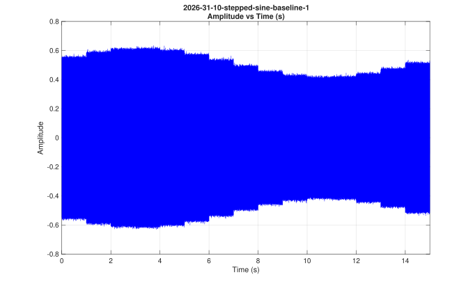
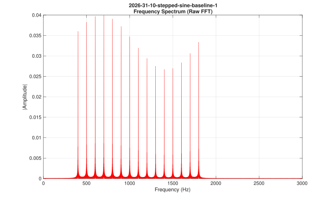
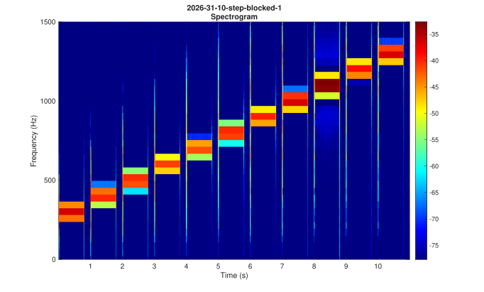

# Acoustic Wave Analysis System

An Object-Oriented MATLAB system for laboratory pipe acoustic wave inspection, hardware data acquisition, signal alignment, per-frequency feature extraction, and multi-trial comparative visualization.

The workflow is streamlined into **two core scripts** (plus an interactive comparison tool):
1. **[`record_acoustic_sample.m`](record_acoustic_sample.m) — Audio Interface & Hardware Monitor GUI**: Interactive studio dashboard for microphone/speaker selection, hot-plug device rescanning, $N$-repeat coherent ensemble averaging, live waveform & FFT peak monitoring, and VU level metering.
2. **[`main.m`](main.m) — Master Batch Pipeline Runner**: Automates Stage 1 (sub-millisecond onset alignment to $t = 0.0\text{ s}$ with $-0.2\text{ s}$ baseline into `logged/*.csv`) and Stage 2 (per-frequency feature extraction into `features_by_frequency.csv` and interactive `.fig` plots into `analyze/`).
3. **[`overlay_figures.m`](overlay_figures.m) — Multi-Figure Overlay & Comparison Engine**: Ingests comma-separated `.fig` paths to overlay 1D curves (`frequency.fig`, `amplitude.fig`) or compute 3-panel synchronized differential spectrograms ($\Delta\text{dB}$) into `analyze/overlay/`.

---

## Prerequisites

- **MATLAB**: Version R2020b or later recommended (supports `audiodevreset` for live USB/Bluetooth hardware rescanning).
- **Required Toolboxes**:
  - `Signal Processing Toolbox` (used for `spectrogram`, `hilbert`, and `findpeaks`; fallback algorithms are built in).

---

## Directory Structure

```text
FRA362-Acoustic-Wave-Analyze-System/
├── sound_input/                                  <-- Pure speaker excitation tracks (selectable in GUI)
│   ├── stepped_tones_100mm_2waves_500ms_gap.wav  <-- 2-wave impulse per freq (2/f_k) + 0.50s gap (8.04s)
│   ├── stepped_tones_100mm_150ms_250ms.wav       <-- 16-step steady burst (150ms tone + 250ms gap, 6.40s)
│   └── stepped_tones_100mm_2s_1s.wav             <-- Legacy 17-step track (300-1900 Hz, 51s)
│
├── mp3/                                          <-- Raw recorded audio from experiments
│   └── {trial_name}/
│       ├── {sample_name}.wav                     <-- Master / ensemble-averaged recording
│       ├── {sample_name}_rep1.wav                <-- Individual raw repeat 1 (when Repeats > 1)
│       ├── {sample_name}_rep2.wav                <-- Individual raw repeat 2 (when Repeats > 1)
│       └── {sample_name}_stimulus.txt            <-- Active stimulus track reference
│
├── logged/                                       <-- Stage 1: Time-aligned & step-tagged CSVs
│   └── {trial_name}/
│       └── {sample_name}.csv                     <-- Time_s, Step_ID, Freq_Input, Amp_1..N, Amp_Avg, Amp_SD
│
├── analyze/                                      <-- Stage 2: Extracted features & interactive .fig plots
│   ├── {trial_name}/
│   │   └── {sample_name}/
│   │       ├── features_by_frequency.csv         <-- 7 acoustic metrics across 16 frequency steps
│   │       ├── amplitude.fig                     <-- Interactive waveform & envelope with coordinate bar
│   │       ├── frequency.fig                     <-- Single-sided FFT spectrum with cut-off guide
│   │       └── spectrogram.fig                   <-- Time-frequency power distribution (dBFS)
│   │
│   └── overlay/                                  <-- Multi-experiment comparison outputs
│       └── {comparison_name}/
│           └── {comparison_name}.fig             <-- Overlaid curves or differential spectrogram
│
├── AudioAnalyzer.m                               <-- Core Object-Oriented acoustic analysis engine
├── record_acoustic_sample.m                      <-- Script 1: Audio Interface & Recorder GUI
├── main.m                                        <-- Script 2: Master Batch Pipeline (mp3 -> logged -> analyze)
├── overlay_figures.m                             <-- Multi-figure comparison & overlay tool
├── log_raw_data.m                                <-- Standalone Stage 1 module (mp3 -> logged)
├── extract_features.m                            <-- Standalone Stage 2 module (logged -> analyze)
├── generate_sound_input.m                        <-- Pure speaker excitation audio generator
├── generate_dummy_data.m                         <-- Synthetic pipe acoustic benchmark generator
└── README.md
```

---

## How to Use (Step-by-Step Guide)

### Step 1: Record Acoustic Samples via the GUI (`record_acoustic_sample.m`)

Launch the Audio Interface GUI from the **MATLAB Command Window**:

```matlab
record_acoustic_sample
```

1. **Select Hardware Devices**:
   - Choose your microphone (e.g., `Microphone (USB Audio CODEC)`) from the **Microphone Input** dropdown.
   - Choose your speaker/amplifier (e.g., `Speakers (Wuzhi Audio)`) from the **Speaker Output** dropdown.
   - *Hot-Plug Support*: If you plug in a USB mic or connect Bluetooth while the GUI is open, click **"Rescan Audio Devices (Refresh)"** to flush MATLAB's audio driver cache (`audiodevreset`) and populate the new hardware immediately.
2. **Choose Operational Mode**:
   - **Mode 1: Automated Test (Play + Record)** *(Recommended)* — Synchronously plays the 16-step tone burst (`300 Hz` to `1800 Hz`, `150 ms` tone + `250 ms` gap) through the speaker while recording the pipe response.
   - **Mode 2: Record Only** — Records microphone input for 7.0 seconds using an external sound source.
   - **Mode 3: Sound Check (Speaker Play Only)** — Plays the excitation track without recording to verify speaker volume.
3. **Configure Trial, Sample Name, Repeats & Stimulus Input**:
   - **Trial Folder**: Group name inside `mp3/` (defaults to `YYYY-MM-DD-sound-sample`).
   - **Sample Name**: Condition identifier (e.g., `sound_sample_01_sand-1-piece-front`). Re-recording with the same name automatically overwrites/replaces the previous file.
   - **Repeats ($N$)**: Set $N = 1$ for a single capture, or $N > 1$ (e.g., `3` or `5`) to run $N$ consecutive repeats automatically.
   - **Stimulus Input Dropdown & Browse**: Select any excitation track from `sound_input/` (such as `stepped_tones_100mm_2waves_500ms_gap.wav` or `stepped_tones_100mm_150ms_250ms.wav`) or click **`Browse...`** to pick any custom `.wav`/`.mp3` file at any time.
4. **Inspect the Live Monitor**:
   - **Top Graph (Oscilloscope)**: Displays raw time-domain waveform $s(t)$.
   - **Bottom Graph (Frequency Spectrum)**: Displays single-sided linear FFT `|Amplitude|` ($0 - 2200\text{ Hz}$) with golden peak markers on the 16 excitation frequencies and the plane-wave cut-off guide ($2028\text{ Hz}$).
   - **Right Meter (VU & Clipping)**: Shows peak level in dBFS. If $|y| \ge 0.95$, the red **CLIP** LED lights up to warn you to lower microphone gain.
   - **Play Recorded Audio**: Plays back the captured wave (with automatic audible gain normalization for quiet signals).

---

### Step 2: Run the Master Analysis Pipeline (`main.m`)

You can trigger the full analysis pipeline in **two ways**:

- **Option A (From the GUI)**: Click the blue **"RUN MASTER PIPELINE (main.m)"** button at the bottom-left of the GUI. This processes the active trial folder immediately.
- **Option B (From the Command Window)**:
  ```matlab
  main                                      % Process all trial folders in mp3/
  main('2026-11-06-sound-sample-test')      % Process a specific trial folder only
  ```

#### What `main.m` Does Automatically:
1. **Stage 1 — Time-Alignment & Raw CSV Logging (`mp3/` $\to$ `logged/`)**:
   - Detects the first excitation burst onset via the Hilbert envelope and anchors the first peak at $t = 0.000\text{ s}$.
   - Retains $0.200\text{ s}$ of quiet pre-trigger baseline ($t$ starts at $-0.200\text{ s}$).
   - Segments the 16 active frequency steps and writes calibrated time-series data to `logged/{trial}/{sample}.csv`.
2. **Stage 2 — Per-Frequency Feature Extraction & Interactive Plotting (`logged/` $\to$ `analyze/`)**:
   - Computes 7 acoustic metrics per frequency step and exports `analyze/{trial}/{sample}/features_by_frequency.csv`.
   - Exports 3 interactive MATLAB `.fig` files (`amplitude.fig`, `frequency.fig`, `spectrogram.fig`) equipped with a live hover coordinate tracking bar and sample data tips.
   - Prints **1-Click Hyperlinks** in the MATLAB Command Window (`[Features CSV]`, `[Amplitude.fig]`, `[Frequency.fig]`, `[Spectrogram.fig]`, `[Folder]`) to open results with a single click.

---

### Step 3: Compare & Overlay Experiments (`overlay_figures.m`)

To compare multiple pipe conditions (e.g., Clean vs. Sand Blockage at Front vs. Middle):

#### Method A: From the GUI
1. Click the purple **"OVERLAY COMPARISON TOOL"** button in the GUI.
2. In the pop-up dialog, paste your relative `.fig` file paths separated by a comma `,`:
   ```text
   analyze/2026-11-06-sound-sample-test/sound_sample_01_sand-1-piece-front/frequency.fig, analyze/2026-11-06-sound-sample-test/sound_sample_01_sand-1-piece/frequency.fig
   ```
3. Enter a comparison name (e.g., `front_vs_middle_freq`) and click **OK**.

#### Method B: From the Command Window
Pass a comma-separated string of `.fig` paths directly:
```matlab
% Compare 1D Frequency Spectra (overlays multi-colored curves on one plot)
overlay_figures('analyze/trial/sampleA/frequency.fig, analyze/trial/sampleB/frequency.fig', 'freq_compare');

% Compare 2D Spectrograms (creates 3-panel synchronized view + Differential dB map)
overlay_figures('analyze/trial/sampleA/spectrogram.fig, analyze/trial/sampleB/spectrogram.fig', 'spec_diff');
```

#### Automatic Plot Mode Detection:
- **For `frequency.fig` or `amplitude.fig` (1D Line Traces)**: Overlays all curves onto a single high-contrast dark axes with distinct studio colors, an automatic legend, and interactive hover tracking.
- **For `spectrogram.fig` (2D Heatmaps)**: Generates a synchronized multi-panel comparison figure containing Condition 1, Condition 2, and the **Differential Spectrogram ($\Delta\text{dB} = \text{dB}_1 - \text{dB}_2$)** with linked time-frequency zoom (`linkaxes`).
- All outputs are saved to `analyze/overlay/{taskName}/{taskName}.fig`.

---

## Exported CSV Data Schemas

### 1. Calibrated Time-Series Log (`logged/{trial}/{sample}.csv`)
Uses a unified column structure for both single ($N=1$) and multi-repeat ($N>1$) experiments (with `Envelope` removed):
- **Single Experiment ($N=1$)**: `Time_s, Step_ID, Freq_Input, Amp_1, Amp_Avg, Amp_SD`
- **Repeats Experiment ($N>1$)**: `Time_s, Step_ID, Freq_Input, Amp_1, Amp_2, ..., Amp_N, Amp_Avg, Amp_SD`

| Column | Name | Description |
| :--- | :--- | :--- |
| **1** | `Time_s` | Calibrated time in seconds (starts at $-0.200\text{ s}$, Step 1 @ $300\text{ Hz}$ anchored at $0.000\text{ s}$ via 16-step comb correlation) |
| **2** | `Step_ID` | Integer frequency step index (`0` = silence gap/baseline, `1..16` = active frequency step) |
| **3** | `Freq_Input` | Scheduled input excitation frequency in Hz (`300` to `1800 Hz` during steps, `0` during gaps) |
| **4..3+N** | `Amp_1 .. Amp_N` | Aligned mono acoustic waveform $s_r(t)$ for each repeat $r = 1 \dots N$ |
| **4+N** | `Amp_Avg` | Ensemble mean waveform across repeats: $\bar{s}(t) = \frac{1}{N}\sum_{r=1}^N s_r(t)$ |
| **5+N** | `Amp_SD` | Sample standard deviation across repeats at each timestamp ($0$ when $N=1$) |

### 2. Per-Frequency Feature Table (`analyze/{trial}/{sample}/features_by_frequency.csv`)
| Column | Name | Description |
| :--- | :--- | :--- |
| **1** | `Step_ID` | Frequency step index (`1` to `16`) |
| **2** | `Freq_Hz` | Detected excitation frequency in Hz (`300` to `1800 Hz`) |
| **3** | `Onset_Time_s` | Aligned start time of the tone burst in seconds |
| **4** | `Duration_s` | Active duration of the tone step in seconds |
| **5** | `Step_RMS` | Root-Mean-Square amplitude across the active tone step |
| **6** | `Step_Peak_Amp` | Maximum Hilbert envelope amplitude within the tone step |
| **7** | `Energy_dB` | Acoustic energy level in decibels ($20 \log_{10}(\text{Step\_RMS})$) |

---

## Output Visualizations (`.fig` Standard)

By default, the system exports interactive MATLAB `.fig` files (`SaveFig = true`, `SaveImage = false`) so you can scroll-zoom, pan, and inspect exact sample points in MATLAB.

### 1. Amplitude vs Time (`amplitude.fig`)
Displays the aligned waveform $s(t)$, instantaneous Hilbert envelope $E(t)$, and shaded step boundaries. Moving the cursor updates the bottom coordinate bar with exact `Time (s)`, `Amplitude`, and `Sample #`.



### 2. Frequency Spectrum (`frequency.fig`)
Displays the single-sided FFT amplitude spectrum ($P_1$) up to $2200\text{ Hz}$ with the plane-wave cut-off boundary marked at $f_c \approx 2028\text{ Hz}$.



### 3. Spectrogram (`spectrogram.fig`)
Displays the short-time Fourier transform (STFT) power spectral density in dB across time and frequency, resolving the 16 discrete tone steps and reverberation tails.



---

## Mathematical & Physical Formulations

### 1. Acoustic Waveguide Cut-Off Frequency ($f_c$)
Ensures sound propagates purely as a 1D **plane wave ($\text{Mode } 0,0$)** without higher-order cross-sectional wall reflections:
$$f_c \approx 0.586 \cdot \frac{v}{D}$$
For a laboratory pipe with diameter $D = 0.10\text{ m}$ ($100\text{ mm}$) and speed of sound $v = 346\text{ m/s}$:
$$f_c \approx 0.586 \times \frac{346}{0.10} \approx 2028\text{ Hz}$$
All 16 excitation steps ($300\text{ Hz}$ to $1800\text{ Hz}$) are kept strictly below $2028\text{ Hz}$.

### 2. Coherent Ensemble Averaging Across $N$ Repeats
For $N$ repeated recordings triggered identically, coherent time-domain averaging computes:
$$\bar{s}(t) = \frac{1}{N} \sum_{k=1}^N s_k(t)$$
Deterministic pipe acoustic responses add constructively while uncorrelated ambient room noise decays by $\sqrt{N}$, improving Signal-to-Noise Ratio by:
$$\Delta \text{SNR} = 10 \log_{10}(N) \text{ dB}$$

### 3. Instantaneous Hilbert Envelope ($E(t)$)
Extracts the phase-independent energy envelope of the oscillating pressure wave:
$$E(t) = \left| s(t) + j \cdot \mathcal{H}\{s(t)\} \right|$$

### 4. Differential Spectrogram Attenuation ($\Delta\text{dB}$)
When comparing two spectrograms $S_A(t, f)$ and $S_B(t, f)$ in [`overlay_figures.m`](overlay_figures.m), the differential power map highlights localized acoustic absorption or resonance shifts caused by blockages:
$$\Delta\text{dB}(t, f) = 10 \log_{10}|S_A(t, f)| - 10 \log_{10}|S_B(t, f)|$$

---

## Programmatic OOP Usage (`AudioAnalyzer.m`)

[`AudioAnalyzer.m`](AudioAnalyzer.m) can also be called directly inside custom scripts:

```matlab
% Initialize engine with custom parameters
analyzer = AudioAnalyzer('', ...
    'AutoAlign', true, ...
    'PreTriggerSeconds', 0.2, ...
    'MaxFrequency', 2200, ...
    'SaveFig', true, ...
    'SaveImage', false);

% Stage 1: Load raw audio and export aligned CSV
analyzer.loadFile('mp3/my_trial/sample_01.wav');
analyzer.exportRawCSV('logged/my_trial/sample_01.csv');

% Stage 2: Load logged CSV, extract per-frequency features, and export .fig plots
T_raw = analyzer.loadFromCSV('logged/my_trial/sample_01.csv');
featTable = analyzer.extractStepFeatures('analyze/my_trial/sample_01/features_by_frequency.csv', T_raw);
analyzer.analyzeAndExport('analyze/my_trial/sample_01');
```
