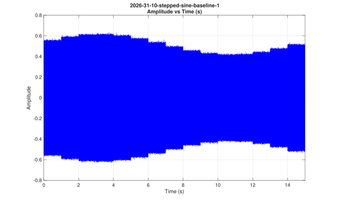
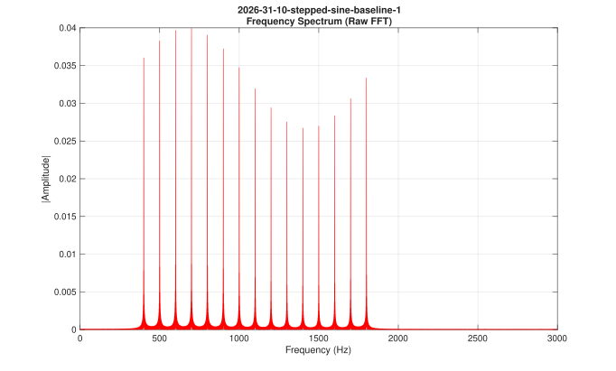
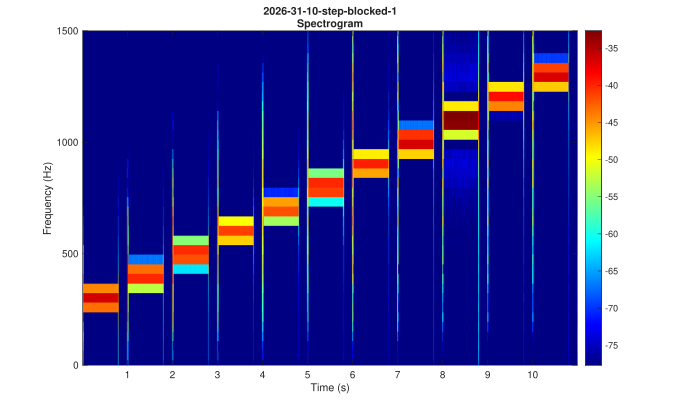

# Acoustic Wave Analysis System

A MATLAB-based batch processing tool designed to extract fundamental acoustic properties from experiment audio recordings (`.mp3` and `.wav`). 

The system automates file discovery across trial folders and generates three core, uncorrupted acoustic representations per audio file without applying distortive filters or speculative conversions:
1. **Amplitude vs Time**: Raw sound pressure waveform envelope.
2. **Frequency Spectrum**: Single-sided FFT magnitude spectrum across the audible band.
3. **Spectrogram**: Time-frequency power distribution resolving stepped-frequency tones over time.

---

## Prerequisites

- **MATLAB**: Version R2019b or later recommended.
- **Required Toolboxes**:
  - `Signal Processing Toolbox` (required for the `spectrogram` function).
  - Base MATLAB covers `audioread`, `fft`, and graphics plotting.

---

## Directory Structure

Place audio recordings in the `mp3` folder organized by trial directories. The script reads this hierarchy and produces identical folder trees in `analyze`:

```text
FRA362-Acoustic-Wave-Analyze-System/
├── mp3/
│   ├── 2026-31-10-trial-a/
│   │   ├── 1.mp3 (or .wav)
│   │   └── 2.mp3
│   └── 2026-31-10-trial-b/
│       └── 1.mp3
│
├── analyze/                             <-- Generated automatically
│   ├── 2026-31-10-trial-a/
│   │   ├── 1/
│   │   │   ├── amplitude.svg / .fig
│   │   │   ├── frequency.svg / .fig
│   │   │   └── spectrogram.svg / .fig
│   │   └── 2/
│   │       └── ...
│   └── 2026-31-10-trial-b/
│       └── ...
│
├── AudioAnalyzer.m                      <-- Object-Oriented acoustic analysis class
├── main.m                               <-- Batch orchestration script
└── README.md
```

---

## Step-by-Step Usage Guide

### Step 1: Prepare Input Audio
Create a subfolder inside `mp3/` named after your trial (e.g., `mp3/2026-31-10-experiment-1/`). Place your recorded audio files inside, named consecutively (e.g., `1.mp3`, `2.mp3`, or `.wav`).

### Step 2: Configure Processing Parameters (Optional)
Open `main.m`. All major analysis parameters are located at the top of the file with explicit defaults:

```matlab
% Time & Frequency Windowing
TIME_RANGE  = [];    % Empty [] processes full duration (e.g., 10-20 seconds)
MAX_AMP     = [];    % Max amplitude limit on y-axis (empty = auto-scale)
MAX_FREQ    = 3000;  % Focus frequency plots up to 3000 Hz

% Spectrogram Resolution
WINDOW_LEN  = 1024;  % Window sample size (balances frequency vs time resolution)
OVERLAP_LEN = 512;   % Number of overlapping samples between segments
SAVE_FORMAT = 'svg'; % Static export format ('svg', 'png', etc.)
SAVE_FIG    = true;  % Save interactive MATLAB .fig files
```

### Step 3: Run Batch Analysis
Run `main.m` directly in the MATLAB Command Window or terminal:

```matlab
main
```

### Step 4: Review Outputs and Command Window Hyperlinks
During processing, the MATLAB Command Window prints clickable links to inspect results immediately:

```text
--- Processing trial [1/1]: 2026-31-10-trial-a (1 files) ---
  [OK] 1.mp3    -> 1-Click: [Amplitude] [Frequency] [Spectrogram] | [Open Folder]
```

- Clicking **`[Amplitude]`**, **`[Frequency]`**, or **`[Spectrogram]`** opens the interactive MATLAB `.fig` file directly in a new figure window with mouse-wheel zoom and pan enabled.
- Clicking **`[Open Folder]`** reveals the export directory in Windows File Explorer.

---

## Output Visualizations

### 1. Amplitude vs Time (`amplitude.svg`)
Displays the raw time-domain signal. Useful for identifying signal start/stop boundaries, transient spikes, and steady-state envelope amplitudes.



### 2. Frequency Spectrum (`frequency.svg`)
Computes the single-sided FFT amplitude spectrum across the analyzed band. Displays resonance peaks, dominant modal frequencies, and harmonic distributions.



### 3. Spectrogram (`spectrogram.svg`)
Computes short-time Fourier transforms to display power distribution across time and frequency. Clarifies discrete frequency steps, frequency drift, and localized acoustic attenuation.



---

## Programmatic OOP Usage

`AudioAnalyzer.m` can also be integrated into custom MATLAB scripts independently:

```matlab
% Instantiate analyzer
analyzer = AudioAnalyzer('mp3/my-trial/1.wav', ...
    'MaxFrequency', 3000, ...
    'WindowLength', 1024, ...
    'OverlapLength', 512, ...
    'SaveFormat', 'svg', ...
    'SaveFig', true);

% Run analysis and export plots to target folder
analyzer.analyzeAndExport('analyze/my-trial/1');
```
