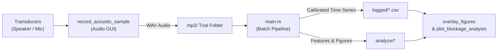
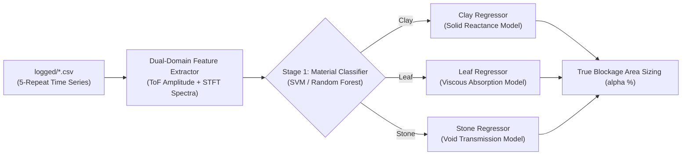

# Acoustic Wave Inspection & Machine Learning System

A dual-engine platform for acoustic pipe inspection, integrating MATLAB hardware acquisition and digital signal processing with Python physics-guided machine learning for sediment material classification and blockage sizing.

| Engine | Primary Scope | Core Interfaces |
| :--- | :--- | :--- |
| **MATLAB** | Hardware recording, onset alignment, Hilbert envelope, STFT feature extraction, `.fig` visualization | `record_acoustic_sample`, `main`, `AudioAnalyzer` |
| **Python** | Dual-domain feature extraction, sediment classification, calibrated blockage regression | `acoustic_blockage_ml_pipeline.ipynb` |

---

## Table of Contents
- [Quick Start & Environment Setup](#quick-start--environment-setup)
  - [Python Virtual Environment](#1-python-virtual-environment-setup)
  - [MATLAB Search Path](#2-matlab-search-path-setup)
- [MATLAB Workflow: Hardware Acquisition & Signal Processing](#matlab-workflow-hardware-acquisition--signal-processing)
- [Python Workflow: Physics-Guided Machine Learning](#python-workflow-physics-guided-machine-learning)
- [Directory Structure](#directory-structure)
- [Data Schemas](#data-schemas)
- [Acoustic Physics Reference](#acoustic-physics-reference)
- [Programmatic MATLAB API](#programmatic-matlab-api)

---

## Quick Start & Environment Setup

### 1. Python Virtual Environment Setup
Run the automated setup script for your platform to create `.venv`, install dependencies from [`requirements.txt`](requirements.txt), and register the Jupyter kernel:

| Platform | Setup Command | Activation Command |
| :--- | :--- | :--- |
| **Windows (PowerShell)** | `.\setup_env.ps1` | `.\.venv\Scripts\Activate.ps1` |
| **Windows (Command Prompt)** | `setup_env.bat` | `.venv\Scripts\activate.bat` |
| **Linux / macOS** | `./setup_env.sh` | `source .venv/bin/activate` |

Launch the machine learning pipeline:
```bash
jupyter notebook acoustic_blockage_ml_pipeline.ipynb
```
Select the **`Python 3 (.venv)`** kernel from the dropdown in Jupyter or VS Code.

### 2. MATLAB Search Path Setup
1. Launch MATLAB (version R2020b or later with `Signal Processing Toolbox`).
2. Set your working directory to the project repository root (`FRA362-Acoustic-Wave-Analyze-System`).
3. [`startup.m`](startup.m) runs automatically on launch, adding [`MATLAB-script/`](MATLAB-script/) to the MATLAB search path.
4. Verify function resolution in the Command Window:
   ```matlab
   which record_acoustic_sample AudioAnalyzer main
   ```

---

## MATLAB Workflow: Hardware Acquisition & Signal Processing

All processing scripts reside in [`MATLAB-script/`](MATLAB-script/) and automatically anchor to the repository root.



### Core Operations

| Task | Interface / Command | Description |
| :--- | :--- | :--- |
| **Hardware Recording** | `record_acoustic_sample` | Studio GUI for mic/speaker selection, hot-plug hardware rescanning (`audiodevreset`), live oscilloscope, FFT spectrum ($0-2200\text{ Hz}$), and $N$-repeat coherent averaging. |
| **Batch Processing** | `main`<br>`main('trial_name')` | Aligns Step 1 onset to $t = 0.000\text{ s}$ via 16-step comb cross-correlation, retains a $0.200\text{ s}$ pre-trigger baseline, and exports calibrated CSVs to `logged/` and interactive `.fig` plots to `analyze/`. |
| **Multi-Curve Overlay** | `overlay_figures('path1.fig, path2.fig', 'task')` | Overlays 1D waveforms/spectra or generates 3-panel synchronized differential spectrograms ($\Delta\text{dB}$) in `analyze/overlay/`. |
| **Blockage Sizing** | `plot_blockage_analysis()` | Interactive tool computing Level 4 Transmission Loss ($\Delta\text{dB}$) and Level 5 Physical Blockage Area ($\alpha\%$). |
| **Physical Experiments** | `plot_physical_experiments(1)`<br>`plot_physical_experiments('all')` | Automated batch runner for Experiment 1 (Time-of-Flight), Experiment 2 (Porosity), and Experiment 3 (Blockage Area). |

---

## Python Workflow: Physics-Guided Machine Learning

The machine learning pipeline consumes calibrated time series from `logged/` to perform **two-stage cascaded diagnostics**:
1. **Material Classification**: Identifies sediment material composition (**Clay**, **Leaf**, or **Stone**) using acoustic impedance and frequency-dependent attenuation signatures.
2. **Calibrated Blockage Regression**: Quantifies cross-sectional blockage area ($\hat{\alpha}\%$) using material-specific calibration laws.



### Feature Architecture & Diagnostic Performance
- **Physics Features**:
  - *Time-Domain Reflectometry*: Leading-edge echo amplitude $A_{\text{echo}}$ at transit delay $\tau_{\text{block}}$, reflection coefficient $R = A_{\text{echo}} / A_{\text{ref}}$, and analytic envelope decay rate.
  - *Spectral Signatures*: High-to-low band energy ratio ($E_{\text{high}} / E_{\text{low}}$), spectral centroid shift, and discrete insertion loss across 16 steps ($300 - 1800\text{ Hz}$).
- **Validation Protocol**: Group-K-Fold cross-validation grouped by physical sample identifier to guarantee zero data leakage between repeated recordings.
- **Diagnostic Benchmarks**:
  - **Material Classification**: $\ge 83.3\%$ cross-validation accuracy across Clay, Leaf, and Stone.
  - **Area Regression**: Correlation $r = 0.964$ ($R^2 > 0.90$), reducing average area estimation error from $24.2\%$ down to **$7.1\%$**.
- Full mathematical derivations and scaling laws are detailed in [`docs/markdown-file/MACHINE_LEARNING.md`](docs/markdown-file/MACHINE_LEARNING.md).

---

## Directory Structure

```text
FRA362-Acoustic-Wave-Analyze-System/
├── MATLAB-script/                                <-- Consolidated MATLAB scripts and analysis engines
│   ├── AudioAnalyzer.m                           <-- Core Object-Oriented acoustic analysis engine
│   ├── record_acoustic_sample.m                  <-- Hardware recorder and oscilloscope GUI
│   ├── main.m                                    <-- Master batch pipeline (mp3 -> logged -> analyze)
│   ├── overlay_figures.m                         <-- Multi-trace comparative overlay engine
│   ├── plot_envelope_overlay.m                   <-- Analytic envelope comparative visualizer
│   ├── plot_acoustic_reflex_map.m                <-- Time-of-Flight spectrogram heatmap engine
│   ├── plot_blockage_analysis.m                  <-- Quantitative blockage assessment engine
│   ├── plot_physical_experiments.m               <-- Physical experiment suite batch runner
│   ├── log_raw_data.m / extract_features.m       <-- Standalone Stage 1 and Stage 2 modules
│   └── generate_sound_input.m                    <-- Excitation audio generator
│
├── startup.m                                     <-- Auto-initializes search path to MATLAB-script/
├── acoustic_blockage_ml_pipeline.ipynb           <-- Interactive Jupyter machine learning pipeline
├── requirements.txt                              <-- Python package dependencies
├── setup_env.ps1 / .bat / .sh                    <-- Automated virtual environment setup scripts
├── CONTEXT.md / README.md                        <-- System specifications and primary documentation
│
├── docs/                                         <-- Technical documentation and reference assets
│   ├── markdown-file/                            <-- Extended markdown guides & physics derivations
│   │   ├── MACHINE_LEARNING.md                   <-- Machine learning architectural plan and formulations
│   │   └── ACOUSTIC_DERIVATION_PIPELINE.md       <-- Detailed acoustic wave derivation pipeline
│   ├── example_plots/                            <-- Example figure assets
│   ├── presentation-slide/                       <-- Presentation slides and causal diagrams
│   └── ref-paper/                                <-- Reference academic literature
│
├── sound_input/                                  <-- Pure excitation tracks (2-wave impulse & steady bursts)
├── mp3/                                          <-- Recorded experimental audio files ({trial}/{sample}.wav)
├── logged/                                       <-- Stage 1: Aligned time-series CSVs (Amp_1..N, Amp_Avg)
└── analyze/                                      <-- Stage 2: Extracted feature CSVs and interactive .fig plots
```

---

## Data Schemas

### 1. Calibrated Time Series (`logged/{trial}/{sample}.csv`)
| Column | Identifier | Description |
| :--- | :--- | :--- |
| **1** | `Time_s` | Aligned timeline in seconds (Step 1 onset anchored at $0.000\text{ s}$; starts at $-0.200\text{ s}$). |
| **2** | `Step_ID` | Frequency step index ($0$ = baseline/silence gap, $1 \dots 16$ = active excitation tone). |
| **3** | `Freq_Input` | Excitation frequency in Hz ($300 - 1800\text{ Hz}$). |
| **4..3+N** | `Amp_1..N` | Calibrated discrete sound pressure amplitudes across $N$ experimental repeats. |
| **4+N** | `Amp_Avg` | Coherent ensemble average: $\bar{s}(t) = \frac{1}{N}\sum_{r=1}^N s_r(t)$. |
| **5+N** | `Amp_SD` | Sample standard deviation across repeats (quantifies ambient acoustic noise). |

### 2. Feature Table Summary (`analyze/{trial}/{sample}/features_by_frequency.csv`)
| Metric | Description | Formula / Scope |
| :--- | :--- | :--- |
| `Step_ID`, `Freq_Hz` | Active step index and dominant excitation frequency | Steps $1 \dots 16$ ($300 - 1800\text{ Hz}$) |
| `Onset_Time_s`, `Duration_s` | Tone burst onset timing and active duration | Derived from Hilbert envelope segmentation |
| `Step_RMS`, `Step_Peak_Amp` | Steady-state RMS amplitude and peak discrete sound pressure | $\text{RMS} = \sqrt{\frac{1}{M}\sum s(t)^2}$, $\max(\|s(t)\|)$ |
| `Energy_dB` | Acoustic energy level relative to digital full scale | $20 \log_{10}(\text{Step\_RMS})$ |

---

## Acoustic Physics Reference

### 1. Duct Plane-Wave Cut-Off Frequency ($f_c$)
Sound propagates exclusively as a 1D plane wave ($\text{Mode } 0,0$) without diagonal wall reflections below:
$$f_c \approx 0.586 \cdot \frac{c}{D}$$
For pipe diameter $D = 0.10\text{ m}$ ($100\text{ mm}$) and sound speed $c = 346\text{ m/s}$, $f_c \approx 2028\text{ Hz}$. All 16 excitation steps ($300 - 1800\text{ Hz}$) operate strictly below $f_c$.

### 2. Boundary Reflection and Area Contraction
At an area contraction from duct area $S_0$ to open area $S_1$ (blockage area ratio $\alpha = 1 - S_1 / S_0$):
$$R = \frac{p_r}{p_i} = \frac{S_0 - S_1}{S_0 + S_1} = \frac{\alpha}{2 - \alpha} \iff \alpha = \frac{2R}{1+R}$$
- **Non-Porous Sediment (Clay)**: Solid boundary causing strong in-phase acoustic reflection with low high-frequency transmission.
- **Fibrous Material (Leaf)**: Frequency-dependent viscous absorption attenuating high frequencies inside the porous matrix.
- **Granular Sediment (Stone)**: Sound transmits through interstitial air voids with 3D phase scattering.

### 3. Coherent Noise Reduction
Averaging across $N$ repeats improves Signal-to-Noise Ratio (SNR) by $\Delta\text{SNR} = 10 \log_{10}(N)\text{ dB}$.

For comprehensive derivations, see [`docs/markdown-file/MACHINE_LEARNING.md`](docs/markdown-file/MACHINE_LEARNING.md) and [`docs/markdown-file/ACOUSTIC_DERIVATION_PIPELINE.md`](docs/markdown-file/ACOUSTIC_DERIVATION_PIPELINE.md).

---

## Programmatic MATLAB API

The core analysis class [`AudioAnalyzer.m`](MATLAB-script/AudioAnalyzer.m) supports direct scripting:

```matlab
% 1. Instantiate analyzer with parameters
analyzer = AudioAnalyzer('', ...
    'AutoAlign', true, ...
    'PreTriggerSeconds', 0.2, ...
    'MaxFrequency', 2200, ...
    'SaveFig', true);

% 2. Stage 1: Ingest raw audio and export calibrated CSV
analyzer.loadFile('mp3/my_trial/sample_01.wav');
analyzer.exportRawCSV('logged/my_trial/sample_01.csv');

% 3. Stage 2: Ingest CSV, extract features, and export figures
T_raw = analyzer.loadFromCSV('logged/my_trial/sample_01.csv');
featTable = analyzer.extractStepFeatures('analyze/my_trial/sample_01/features_by_frequency.csv', T_raw);
analyzer.analyzeAndExport('analyze/my_trial/sample_01');
```
