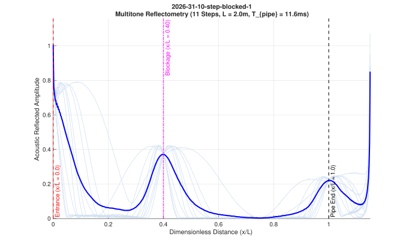

# Acoustic Wave Analysis System

A MATLAB-based batch processing tool designed to extract fundamental acoustic properties from experiment audio recordings (`.mp3` and `.wav`). 

The system automates file discovery across trial folders and generates four core acoustic representations per audio file:
1. **Amplitude vs Time**: Raw sound pressure waveform envelope.
2. **Frequency Spectrum**: Single-sided FFT magnitude spectrum with plane-wave cut-off limit guide.
3. **Spectrogram**: Time-frequency power distribution resolving discrete stepped-frequency tones over time.
4. **Amplitude vs Dimensionless Distance**: Leading-edge time-gated acoustic pulse reflectometry ($\bar{x} = x/L$ from 0 to 1.15).

---

## Prerequisites

- **MATLAB**: Version R2019b or later recommended.
- **Required Toolboxes**:
  - `Signal Processing Toolbox` (required for the `spectrogram` function).
  - Base MATLAB covers `audioread`, `fft`, and graphics plotting.

---

## Directory Structure

Place audio recordings in the `mp3` folder organized by trial directories. The script reads this hierarchy and produces identical folder trees in `analyze`:

```text
FRA362-Acoustic-Wave-Analyze-System/
├── mp3/
│   ├── 2026-31-10-trial-a/
│   │   ├── 1.mp3 (or .wav)
│   │   └── 2.mp3
│   └── 2026-31-10-trial-b/
│       └── 1.mp3
│
├── analyze/                             <-- Generated automatically
│   ├── 2026-31-10-trial-a/
│   │   ├── 1/
│   │   │   ├── amplitude.svg / .fig
│   │   │   ├── frequency.svg / .fig
│   │   │   ├── spectrogram.svg / .fig
│   │   │   └── amplitude-distance.svg / .fig
│   │   └── 2/
│   │       └── ...
│   └── 2026-31-10-trial-b/
│       └── ...
│
├── AudioAnalyzer.m                      <-- Object-Oriented acoustic analysis class
├── main.m                               <-- Batch orchestration script
└── README.md
```

---

## Step-by-Step Usage Guide

### Step 1: Prepare Input Audio
Create a subfolder inside `mp3/` named after your trial (e.g., `mp3/2026-31-10-experiment-1/`). Place your recorded audio files inside, named consecutively (e.g., `1.mp3`, `2.mp3`, or `.wav`).

### Step 2: Configure Processing Parameters (Optional)
Open `main.m`. All major analysis parameters are located at the top of the file with explicit defaults:

```matlab
% Time & Frequency Windowing
TIME_RANGE  = [];    % Empty [] processes full duration (e.g., 10-20 seconds)
MAX_AMP     = [];    % Max amplitude limit on y-axis (empty = auto-scale)
MAX_FREQ    = 3000;  % Focus frequency plots up to 3000 Hz

% Spectrogram Resolution
WINDOW_LEN  = 1024;  % Window sample size (balances frequency vs time resolution)
OVERLAP_LEN = 512;   % Number of overlapping samples between segments
SAVE_FORMAT = 'svg'; % Static export format ('svg', 'png', etc.)
SAVE_FIG    = true;  % Save interactive MATLAB .fig files
```

### Step 3: Run Batch Analysis
Run `main.m` directly in the MATLAB Command Window or terminal:

```matlab
main
```

### Step 4: Review Outputs and Command Window Hyperlinks
During processing, the MATLAB Command Window prints clickable links to inspect results immediately:

```text
--- Processing trial [1/1]: 2026-31-10-trial-a (1 files) ---
  [OK] 1.mp3    -> 1-Click: [Amplitude] [Frequency] [Spectrogram] [Amp-Dist] | [Open Folder]
```

- Clicking **`[Amplitude]`**, **`[Frequency]`**, **`[Spectrogram]`**, or **`[Amp-Dist]`** opens the interactive MATLAB `.fig` file directly in a new figure window with mouse-wheel zoom and pan enabled.
- Clicking **`[Open Folder]`** reveals the export directory in Windows File Explorer.

---

## Output Visualizations

### 1. Amplitude vs Time (`amplitude.svg`)
Displays the raw time-domain signal. Useful for identifying signal start/stop boundaries, transient spikes, and steady-state envelope amplitudes.


### 2. Frequency Spectrum (`frequency.svg`)
Computes the single-sided FFT amplitude spectrum across the analyzed band. Displays resonance peaks, dominant modal frequencies, and harmonic distributions.


### 3. Spectrogram (`spectrogram.svg`)
Computes short-time Fourier transforms to display power distribution across time and frequency. Clarifies discrete frequency steps, frequency drift, and localized acoustic attenuation.


### 4. Amplitude vs Dimensionless Distance (`amplitude-distance.svg`)
Extracts the initial leading-edge transit window ($t_0$ to $t_0 + 1.15 \cdot T_{\text{pipe}}$) across all frequency steps and maps time delay directly to dimensionless distance ($\bar{x} = x/L$). Clearly highlights the pipe entrance ($\bar{x} = 0.0$), blockage reflection peak ($\bar{x}_{\text{blockage}}$), and the open pipe end reflection ($\bar{x} = 1.0$). Faint background lines represent individual frequency steps, while the solid thick blue line represents the composite multitone average.



---

## Mathematical & Physical Formulations

The analysis pipeline applies the following acoustic formulations:

### 1. Acoustic Waveguide Cut-Off Frequency ($f_c$)
Ensures sound propagates purely as a one-dimensional **plane wave (Mode 0,0)** without higher-order cross-mode diagonal wall reflections or phase dispersion:
$$f_c \approx 0.586 \cdot \frac{v}{D}$$
For a laboratory pipe with diameter $D = 0.15\text{ m}$ (150 mm) and speed of sound $v = 346\text{ m/s}$:
$$f_c \approx 0.586 \times \frac{346}{0.15} \approx 1352\text{ Hz}$$
All discrete excitation tones are kept strictly below this frequency.

### 2. Characteristic Pipe Round-Trip Transit Time ($T_{\text{pipe}}$)
The time required for an acoustic wave to travel from the entrance to the pipe end ($L$) and return to the microphone:
$$T_{\text{pipe}} = \frac{2L}{v}$$
For a 2.0-meter pipe: $T_{\text{pipe}} = \frac{2 \times 2.0}{346} \approx 11.56\text{ ms}$.

### 3. Dimensionless Distance Normalization ($\bar{x}$)
Converts the leading-edge reflection time delay ($t - t_0$) into dimensionless distance ($\bar{x} = x/L$):
$$\bar{x} = \frac{x}{L} = \frac{v \cdot (t - t_0)}{2L} = \frac{t - t_0}{T_{\text{pipe}}}$$
- $\bar{x} = 0.00$: Speaker/microphone entrance.
- $\bar{x} = \bar{x}_{\text{blockage}}$: Known physical blockage location ($x_{\text{blockage}} / L$).
- $\bar{x} = 1.00$: Open pipe end reflection.

### 4. Amplitude Envelope via Hilbert Transform ($E(t)$)
Calculates the instantaneous upper amplitude boundary of the acoustic wave oscillations:
$$E(t) = \left| s(t) + j \cdot \mathcal{H}\{s(t)\} \right|$$
where $\mathcal{H}\{s(t)\}$ is the Hilbert transform of the acoustic signal $s(t)$.

### 5. Composite Multitone Stacking / Averaging ($\bar{E}(\bar{x})$)
Averages the extracted envelopes across all $K$ frequency steps ($k = 1, \dots, K$):
$$\bar{E}(\bar{x}) = \frac{1}{K} \sum_{k=1}^K E_k(\bar{x})$$
Physical reflections (entrance, blockage, pipe end) reinforce constructively across all frequencies, while non-physical ripples and random background noise cancel out.

### 6. Acoustic Dynamic Similitude (Helmholtz Number Scaling)
Preserves acoustic wave behavior between the laboratory model and full-scale sewer pipeline:
$$He = \frac{f \cdot L}{v} \implies f_{\text{model}} = f_{\text{real}} \times \left(\frac{L_{\text{real}}}{L_{\text{model}}}\right)$$
Testing at 300–1300 Hz in a 2.0-meter model directly represents the 50–216 Hz acoustic spectrum in a 12.0-meter real pipeline ($6\times$ scale factor).

---

## Programmatic OOP Usage

`AudioAnalyzer.m` can also be integrated into custom MATLAB scripts independently:

```matlab
% Instantiate analyzer
analyzer = AudioAnalyzer('mp3/my-trial/1.wav', ...
    'MaxFrequency', 3000, ...
    'WindowLength', 1024, ...
    'OverlapLength', 512, ...
    'SaveFormat', 'svg', ...
    'SaveFig', true);

% Run analysis and export plots to target folder
analyzer.analyzeAndExport('analyze/my-trial/1');
```
